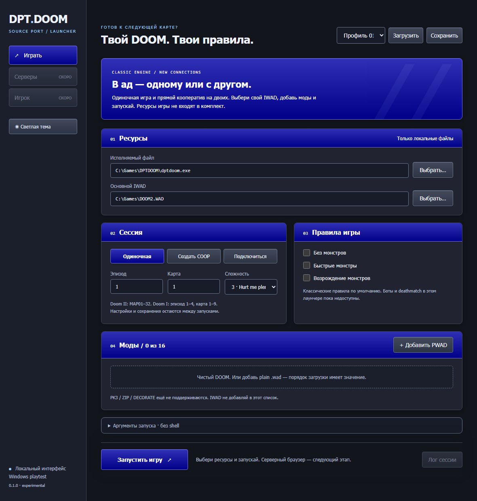
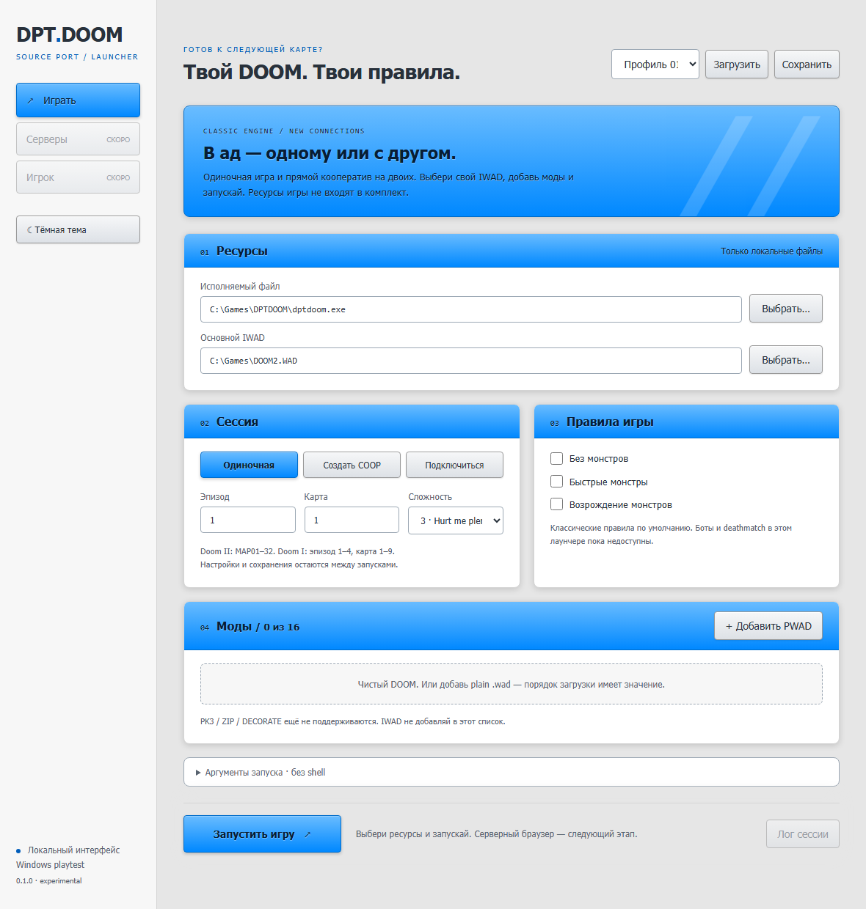
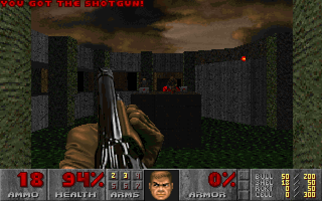
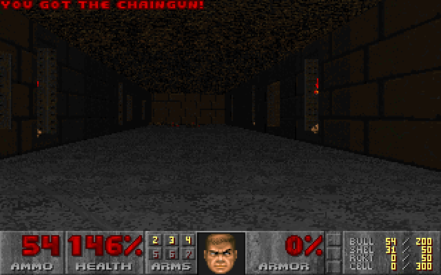
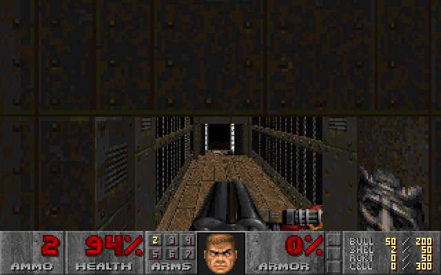

# DPT.DOOM

Свой source port Doom на основе [DoomGeneric](https://github.com/ozkl/doomgeneric).
Основная платформа разработки — Windows; переносимые бэкенды сохраняются.


## Посмотреть

Windows HTML launcher: локальные ресурсы, профили, одиночная игра и direct COOP.
Тёмная и светлая темы переключаются внутри приложения.

| Тёмная тема | Светлая тема |
|---|---|
|  |  |

**Игра — настоящие кадры DPT.DOOM из Doom II demo playback:**



| DEMO2 | DEMO3 |
|---|---|
|  |  |

Снимки сняты автоматически из WebView2 и кадрового буфера движка — без рамок
окон, рабочего стола и OpenCode. Пути в launcher — демонстрационные.
Игровые кадры иллюстрируют работу порта: Doom II и его графика принадлежат
соответствующим правообладателям, **IWAD в комплект не входит**.
Как переснять: [docs/images/README.md](docs/images/README.md).

## Быстрый старт: Windows

Нужны CMake 3.21+, Visual Studio 2022 (C++/Windows SDK) и собственный IWAD.
Для локальной разработки положить Doom II в `refs/iwads/doom2.wad`.
`refs/` и WAD-файлы не попадают в Git.

```powershell
powershell -NoProfile -File tools/fetch-webview2.ps1
cmake --preset windows
cmake --build --preset windows
& ./build/windows/Release/dptdoom.exe -iwad refs/iwads/doom2.wad
```

В текущем этапе есть Win32-сборка, брендинг/иконка и headless для автоматических
проверок. Есть **экспериментальный direct coop для двух игроков** на доверенной
LAN/loopback; это ещё не готовый Internet multiplayer. Есть Windows HTML launcher
и нативный master directory-прототип: opt-in публикация waiting host и список
серверов с IP/доменом master в launcher. Записи UNVERIFIED, без port/NAT proof.
Есть opt-in [direct + relay](docs/RELAY.md) через master при недоступном прямом
порте; это дополнительный транспорт, не защищённый публичный game server.
Игровой dedicated server, P2P/PK3 и DECORATE **ещё не реализованы**.
Нативный Win32 backend пока без звука; для звука использовать SDL backend.
Для игры со звуком есть проверенная Windows SDL2-сборка:

```powershell
powershell -NoProfile -File tools/fetch-sdl.ps1
powershell -NoProfile -File tools/fetch-webview2.ps1
cmake --preset windows-sdl
cmake --build --preset windows-sdl
& ./build/windows-sdl/Release/dptdoom.exe -iwad refs/iwads/doom2.wad
```

SDL2 2.32.10 и SDL2_mixer 2.8.2 скачиваются из официальных релизов в
`build/deps` с проверкой SHA-256. Библиотеки не устанавливаются в систему.
Сборка копирует нужные SDL DLL рядом с EXE. MIDI под Windows использует
доступный системный синтезатор; звук через RDP подтверждён владельцем.

- [Сборка и тестирование, включая headless](docs/TESTING.md)
- [План и текущее состояние](docs/ROADMAP.md)
- [Потиковая диагностика и тесты сохранений](docs/STATE-TESTING.md)
- [AddressSanitizer и найденные ошибки](docs/SANITIZERS.md)
- [CI-матрица и границы автоматических проверок](docs/CI.md)
- [Прямой кооператив: запуск и ограничения](docs/NETWORK.md)
- [Идеи: большие серверы, боты и правила матча](docs/IDEAS.md)
- [Windows launcher](docs/LAUNCHER.md)
- [Нативный master directory-прототип](docs/MASTER.md)
- [Баги, причины и статус исправлений](docs/BUGS.md)
- [Разбор upstream PR](docs/UPSTREAM.md)
- [DeHackEd: ограниченный subset, включая Thing и Frame/Weapon graph](docs/DEHACKED.md)
- [Требования владельца](PROMPT.md)

## Другие платформы и настройки

После успешного GitHub Actions run тестовые сборки доступны в **Artifacts**:
`dptdoom-windows-x64-sdl-<commit>` — игровой Windows ZIP; headless-пакеты —
диагностические, без окна. IWAD нужно предоставить свой. Подробнее: [CI.md](docs/CI.md).
В этой сессии remote run/upload ещё не выполнялся; пуш без команды не делается.

**Прикол с демо:** во время игрового attract-demo можно нажать F2 и сохранить
показанный момент. Демо продолжит играть, а после F3/load ты получишь управление
в одиночной игре. Для титульной картинки без уровня это не работает.

Корневой CMake выбирает Win32 на Windows, X11 на Linux/Unix и SDL на macOS.
Можно явно указать `-DDPTDOOM_BACKEND=win32|x11|sdl|headless`.
Для SDL нужны CMake-пакеты SDL2 и, с `-DDPTDOOM_SOUND=ON`, SDL2_mixer.
Конфигурации Linux/macOS в форке пока не протестированы.

Release/MinSizeRel используют LTO при поддержке компилятора; отключение:
`-DDPTDOOM_LTO=OFF`. CRT остаётся штатным. `fast-math` не используется.
Старые Makefile и VS solution сохранены как legacy; рекомендуемый путь — CMake.
Названия исходных файлов/API DoomGeneric пока намеренно сохранены для upstream diff.

## Лицензия и происхождение

См. [LICENSE](LICENSE) и copyright-заголовки исходных файлов. DPT.DOOM сохраняет
происхождение DoomGeneric, Chocolate Doom и оригинального Doom от id Software.
Коммерческие игровые данные не включены; лицензия движка не распространяет права
на IWAD. README.TXT — исторический документ исходной кодовой базы.

---

## Исходная документация DoomGeneric

The purpose of doomgeneric is to make porting Doom easier.
Of course Doom is already portable but with doomgeneric it is possible with just a few functions.

To try it you will need a WAD file (game data). If you don't own the game, shareware version is freely available (doom1.wad).

# porting
Create a file named doomgeneric_yourplatform.c and just implement these functions to suit your platform.
* DG_Init
* DG_DrawFrame
* DG_SleepMs
* DG_GetTicksMs
* DG_GetKey

|Functions            |Description|
|---------------------|-----------|
|DG_Init              |Initialize your platfrom (create window, framebuffer, etc...).
|DG_DrawFrame         |Frame is ready in DG_ScreenBuffer. Copy it to your platform's screen.
|DG_SleepMs           |Sleep in milliseconds.
|DG_GetTicksMs        |The ticks passed since launch in milliseconds.
|DG_GetKey            |Provide keyboard events.
|DG_SetWindowTitle    |Not required. This is for setting the window title as Doom sets this from WAD file.

### main loop
At start, call doomgeneric_Create().

In a loop, call doomgeneric_Tick().

In simplest form:
```
int main(int argc, char **argv)
{
    doomgeneric_Create(argc, argv);

    while (1)
    {
        doomgeneric_Tick();
    }
    
    return 0;
}
```

# sound
Sound is much harder to implement! If you need sound, take a look at SDL port. It fully supports sound and music! Where to start? Define FEATURE_SOUND, assign DG_sound_module and DG_music_module.

# platforms
Ported platforms include Windows, X11, SDL, emscripten. Just look at (doomgeneric_win.c, doomgeneric_xlib.c, doomgeneric_sdl.c).
Makefiles provided for each platform.

## emscripten
You can try it directly here:
https://ozkl.github.io/doomgeneric/

emscripten port is based on SDL port, so it supports sound and music! For music, timidity backend is used.

## Windows


## X11 - Ubuntu


## X11 - FreeBSD


## SDL

